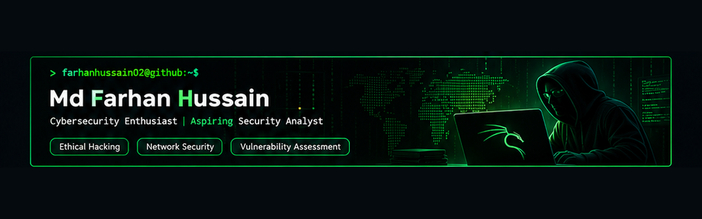

  

### Md Farhan Hussain | Cybersecurity Enthusiast

---

## `whoami`

I'm Md Farhan Hussain, a BCA student passionate about cybersecurity, ethical hacking, and network security.

- Exploring penetration testing and vulnerability assessment.
- Practicing with industry-standard security tools.
- Building hands-on cybersecurity projects.
- Interested in Security Analyst and SOC Analyst opportunities.

**Objective:** Turn practical cybersecurity knowledge into real-world security solutions.

## `Tech Stack`

### Security Tools

### Programming & Development

### Technologies

## `Featured Projects`

<h2 align="center">Technical Skills</h2>

<h3>Cybersecurity Tools</h3>

<h3>Programming Languages</h3>

<h3>Development & Technologies</h3>

### Cybersecurity Labs
Hands-on security learning and practical exercises.

- Network scanning
- Phishing email analysis
- Vulnerability assessment
- Network traffic analysis

## `Current Focus`

- Network Security
- Vulnerability Assessment
- Penetration Testing
- Security Operations (SOC)
- Python for Cybersecurity

---

**farhanhussain02 | Cybersecurity**

